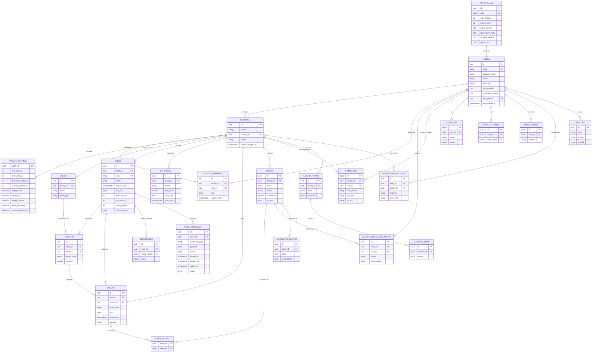

# Схема бази даних «Оберіг»

СУБД: PostgreSQL 16. Моделі описано в `server/app/models/`, міграції — в `server/alembic/`.
Усі часові мітки зберігаються в UTC (`timestamptz`); показ у часовому поясі користувача виконують клієнти.

## ER-діаграма

## Відповідність вимогам Vision & Scope

| Вимога | Рішення в схемі |
|---|---|
| Режими охорони, зокрема «Вдома» (ФМ-1) | `facilities.mode`: `disarmed`, `exit_delay`, `armed_away`, `armed_home`, `entry_delay`, `alarm` |
| Параметри з розділу 2.2.2 (вікна, ваги, пороги) | `facility_settings`, значення за замовчуванням збігаються з документом |
| Усунення дублікатів (ключ «вузол — датчик — тип — номер») | Унікальне обмеження `uq_events_dedup_key` у `events` |
| Журнал постановки й зняття лише для додавання (ПК-3) | `arming_log`, `alarm_acknowledgements`, `audit_log`; заборона зміни й видалення — тригерами в міграції `0002` |
| Індекс достовірності й тривоги | `alarms.confidence`, `alarms.level`; зв'язок із подіями через `alarm_events` |
| Статистика хибних спрацювань (FAR) | `alarms.is_false` та `alarm_events` → `events.sensor_id`; обчислюється запитом |
| Ролі й гостьовий доступ у часових межах | `facility_members.role`, `access_from`, `access_until` |
| Тарифні плани з обмеженнями (ВО-8) | `tariff_plans`, початкові дані (basic, standard, professional) додаються міграцією `0002` |
| Хронологія інциденту (факти й припущення окремо) | `incident_summaries.facts` і `.assumptions` |
| Відтворення тестових сценаріїв | `test_scenarios`, `scenario_runs` |
| Адміністрування: резервні копії, сертифікати | `backups`, `certificates` |
| Захист даних (GDPR): видалення й експорт | `users.anonymized_at`, `users.privacy_consent_at`, `audit_log` |
| Інтернаціоналізація | `users.locale`, `users.timezone`, `users.measurement_system`; час у UTC |
| Недоступність вузла | `nodes.status`, `nodes.last_seen_at`, події `node_offline` та `node_online` |
| Налаштування вузла (ІК-2, ІК-3, ІК-8) | `nodes.debounce_ms`, `nodes.pir_lockout_s`, `nodes.config_version` |
| Підписані команди вузлу (ІК-7) | `node_commands` (тип, `payload`, `nonce` з унікальним `(node_id, nonce)`, строк дії, стан доставки); ключ підпису `nodes.command_key` |

## Міграції

| Міграція | Зміст |
|---|---|
| `0001_initial_schema` | 23 таблиці, первинні й зовнішні ключі, обмеження CHECK, індекси |
| `0002_tariffs_triggers_indexes` | Тарифні плани; тригер `forbid_log_change` для `arming_log`, `alarm_acknowledgements`, `audit_log`; індекси `ix_alarms_facility_status`, `ix_audit_log_entity`; унікальний `uq_nodes_device_token_hash` |
| `0003_business_logic` | Статус тривоги `cancelled`; `users.blocked_at` і `users.time_format`; `scenario_runs.mismatches`; індекс `ix_events_dedup_window`; ключ `uq_events_dedup_key` знову вважає NULL різними (службові події вузла) |
| `0004_iot_commands` | `nodes.debounce_ms`, `pir_lockout_s`, `config_version`, `command_key` з обмеженнями CHECK; таблиця `node_commands` з `uq_node_commands_node_nonce` та індексом за `node_id` |
| `0005_schedule_runs` | `schedules.last_run_at` — момент останнього виконаного запуску розкладу |

Повна структура таблиць зі стовпцями й типами — на діаграмі
[`diagrams/db-structure.png`](diagrams/db-structure.png). Її генерує скрипт
`server/scripts/gen_db_diagram.py` з моделей, тому вона завжди відповідає коду.

### Індекси під типові запити

| Запит | Індекс |
|---|---|
| Стрічка подій об'єкта за часом | `ix_events_facility_occurred (facility_id, occurred_at)` |
| Події датчика за часом (статистика FAR) | `ix_events_sensor_occurred (sensor_id, occurred_at)` |
| Усунення дублікатів у вікні Δ(дубл.) | `ix_events_dedup_window (sensor_id, event_type, occurred_at)` |
| Тривоги об'єкта за часом і за станом | `ix_alarms_facility_opened`, `ix_alarms_facility_status` |
| Журнал охорони об'єкта | `ix_arming_log_facility_created (facility_id, created_at)` |
| Аудит щодо сутності | `ix_audit_log_entity (entity_type, entity_id)` |
| Автентифікація вузла за токеном | `uq_nodes_device_token_hash` |

## Обробка даних у ЛБ3

| Задача | Як реалізовано в БД |
|---|---|
| Поточна тривога об'єкта | `alarms.status IN ('open', 'acknowledged')`, індекс `ix_alarms_facility_status` |
| Скасована тривога (зняття під час затримки входу) | `alarms.status = 'cancelled'`, не враховується у FAR |
| Статистика FAR | `GROUP BY` за датчиками (`alarm_events` -> `events.sensor_id`), зонами (`alarms.zone_id`) і годиною доби (`timezone(tz, opened_at)`) |
| Строк зберігання | події й закриті тривоги старші за `tariff_plans.archive_days` власника видаляються пакетами по 1000 |
| Резервні копії | логічний дамп таблиць у JSON (gzip), реєстр у `backups` (sha256, розмір, статус) |
| Сертифікати вузлів | `certificates` (PEM, серійний номер, строки, статус); приватні ключі не зберігаються |
| Сортування назв | ICU-правила `uk-UA-x-icu`, `en-US-x-icu` у `ORDER BY ... COLLATE` |

